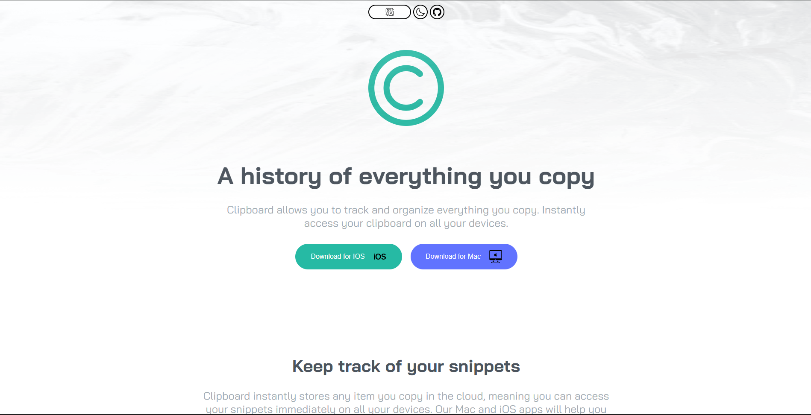
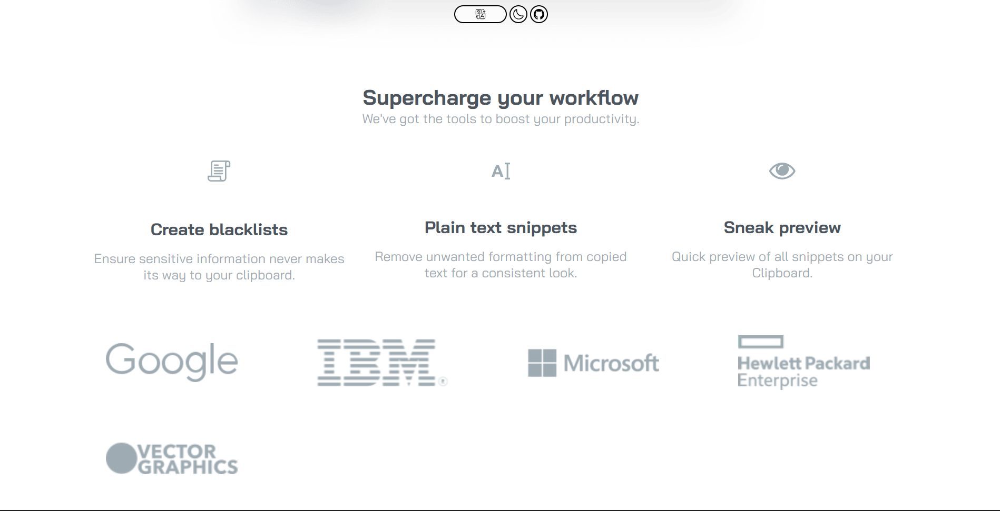
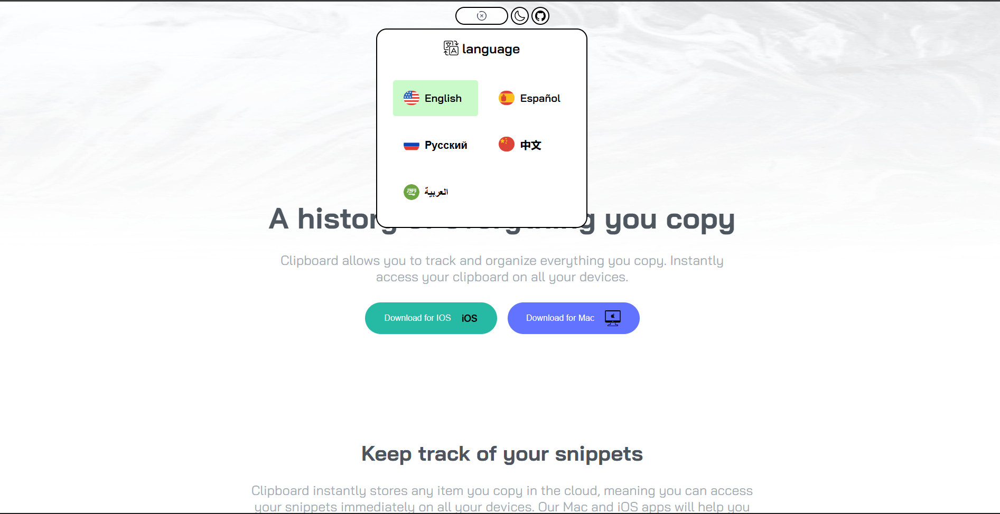
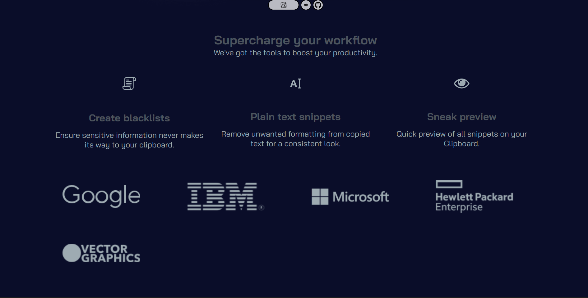
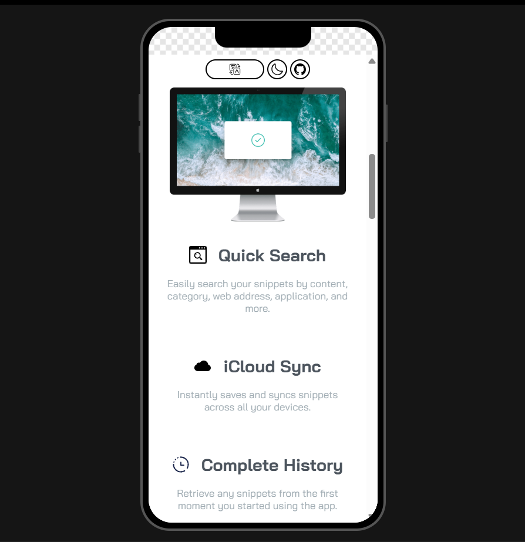
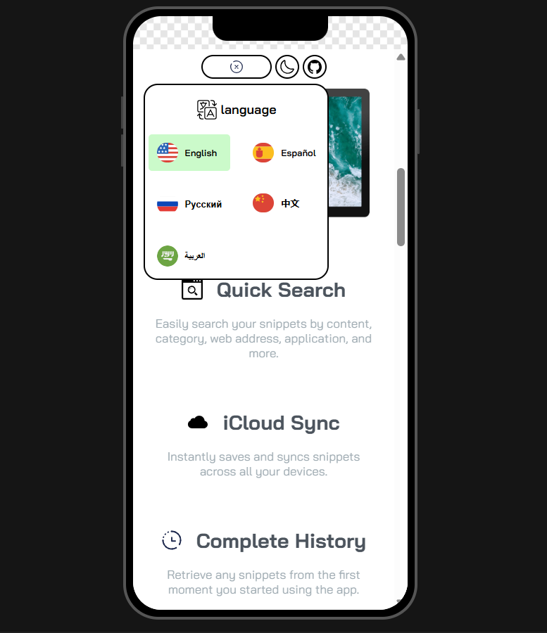

# Frontend Mentor - Clipboard Landing Page Solution

This is my solution to the [Clipboard Landing Page challenge on Frontend Mentor](https://www.frontendmentor.io/challenges/clipboard-landing-page-5cc9bccd6c4c91111378ecb9).

The project is a responsive landing page built with HTML, CSS, and JavaScript. I extended the original challenge by adding a language selector, dark mode, and additional interactive features.

## Table of Contents

- [Overview](#overview)
- [Features](#features)
- [Built With](#built-with)
- [What I Learned](#what-i-learned)
- [Continued Development](#continued-development)
- [AI Collaboration](#ai-collaboration)
- [Live Demo](#live-demo)
- [Screenshoot](#screenshoot)
- [Author](#author)

## Overview

### The Challenge

Users should be able to:

- View an optimized layout across different screen sizes.
- See hover states on interactive elements.
- Navigate the landing page on desktop, tablet, and mobile devices.

### Additional Features

Beyond the original challenge, I implemented:

- **Dark Mode:** Switch between light and dark themes.
- **Multilingual Support:** Browse the website in multiple languages.
- **Language Selector:** A custom dropdown menu for switching languages.
- **Responsive Design:** Layout adjustments for different screen sizes.
- **Interactive Navigation:** JavaScript-powered menu interactions.
- **Social Links:** Quick access to my developer profiles.

### Supported Languages

| Language | Code |
|---|---|
| English | `en` |
| Spanish | `es` |
| Russian | `ru` |
| French | `fr` |
| Simplified Chinese | `zh` |
| Arabic | `ar` |

## Built With

- Semantic HTML5
- CSS3
- CSS Custom Properties
- CSS Flexbox
- CSS Grid
- CSS Media Queries
- JavaScript (ES6)
- DOM Manipulation
- Responsive Web Design

## What I Learned

### 1. Responsive Web Design

I improved my ability to create layouts that adapt to different screen sizes using Flexbox, CSS Grid, and media queries.

### 2. DOM Manipulation

I practiced selecting HTML elements, handling click events, and dynamically updating elements using JavaScript.

For example:

```js
menu.classList.toggle('active');
```

### 3. Dark Mode

I learned how to switch between light and dark themes using JavaScript and CSS classes.

I also explored adjusting SVG icon appearance to improve visibility against dark backgrounds.

### 4. Multilingual Websites

I learned how to organize multiple language versions of a website while maintaining consistent layouts and navigation.

I also gained experience working with different text lengths, character sets, and right-to-left languages.

### 5. Code Organization

I practiced organizing HTML elements semantically, keeping CSS styles maintainable, and writing JavaScript for interactive features.

## Continued Development

In future projects, I want to focus on:

- Improving accessibility and keyboard navigation.
- Writing cleaner and more reusable JavaScript.
- Strengthening responsive layout techniques.
- Improving multilingual support.
- Building more interactive user interfaces.
- Learning advanced JavaScript and React.

## AI Collaboration

I used ChatGPT as a learning assistant during this project.

AI helped me with:

- Understanding and debugging JavaScript.
- Exploring solutions for dark mode and language navigation.
- Improving translations for multilingual pages.
- Reviewing implementation ideas and code structure.

I used these suggestions to support my learning while practicing and implementing the website myself.

## Live Demo

- *Live Demo*:*https://example*

## ScreenShoot

<p align="center">
  
  
  
  
  
  
</p>

## Author

- **Developer:** Azeddine Zahraoui
- **GitHub:** [@aazeddijne](https://github.com/aazeddijne)
- **Instagram:** [@aazeddijne](https://www.instagram.com/aazeddijne/)
- **LinkedIn:** [Azeddine Zahraoui](https://www.linkedin.com/in/azeddine-zahraoui-131079431/)
- **freeCodeCamp:** [@aazeddijne](https://www.freecodecamp.org/aazeddijne)

## Acknowledgments

Thanks to [Frontend Mentor](https://www.frontendmentor.io/) for providing this challenge and helping developers improve their front-end skills through practical projects.
